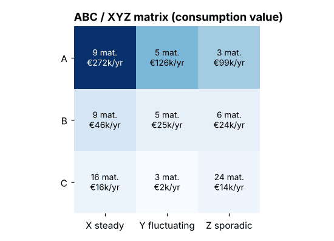
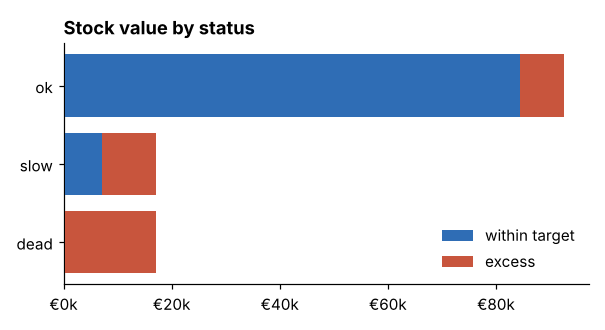
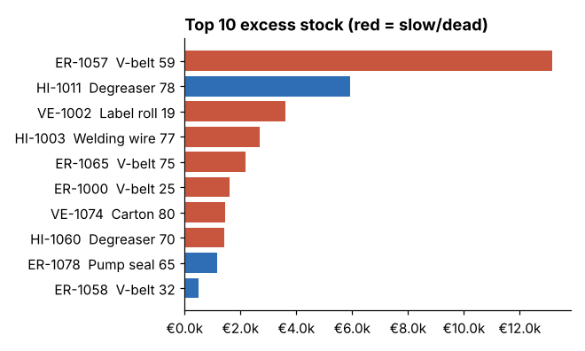
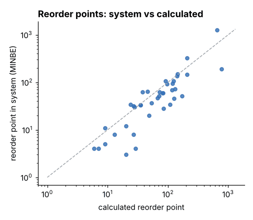

# sap-inventory-optimization

A small Python tool to review MRP settings and stock levels, the way I'd prepare for an inventory workshop: ABC/XYZ classification, safety stock and reorder point calculation, lot size, slow movers / dead stock, and a suggested MRP type per material.

Input is shaped like SAP data (MARC, MBEW, MARD, MSEG), so it works on a real extract with small changes. The sample data is generated - nothing from a real company.



## Why

In most plants I've seen, reorder points and safety stocks were set once and never touched again. Demand changes, lead times change, and the MRP settings drift. The result is the usual mix - too much stock of things nobody uses, and stock-outs on the things that matter.

This script answers a few simple questions per material:

- How valuable is it (ABC) and how predictable is the demand (XYZ)?
- With today's demand and lead time, what should safety stock and reorder point be?
- Is the current MRP type a good fit?
- How much stock is above what we need? What hasn't moved in 6 / 12 months?

## How it calculates

| | |
|---|---|
| **ABC** | annual consumption value, A = top 80%, B = next 15%, C = rest |
| **XYZ** | coefficient of variation of weekly demand: X < 0.5, Y < 1.0, Z above (or no demand) |
| **Safety stock** | z(service level) x std dev of weekly demand x sqrt(lead time in weeks) |
| **Reorder point** | avg weekly demand x lead time in weeks + safety stock |
| **Lot size** | EOQ = sqrt(2 x annual qty x order cost / (price x holding rate)) |
| **Excess** | stock above reorder point + EOQ |
| **Slow / dead** | no goods issue for 26 / 52 weeks |

Lead time is the planned delivery time (MARC-PLIFZ). Lead time variability isn't included - with real data you could add it from PO history (EKBE goods receipt date vs PO date).

MRP type suggestion - a starting point for discussion, not a rule:

| | X steady | Y fluctuating | Z sporadic |
|---|---|---|---|
| **A** | VB reorder point | PD MRP | PD MRP |
| **B** | VB reorder point | PD MRP | PD MRP |
| **C** | VB reorder point | VB reorder point | ND / on demand |

Dead stock always gets ND plus a note - that's a scrap / return / sell discussion, not a planning one. VB and VM are treated as the same thing (both reorder point planning).

## Run it

```bash
pip install -r requirements.txt

python run.py                          # uses data/ - generated on first run
python run.py --service-level 0.98     # see what 98% does to safety stock
python run.py --order-cost 80 --holding-rate 0.25
```

Output:

- `output/recommendations.csv` - one line per material with all numbers and a comment like *"MRP type VB -> PD; reorder point 52 vs calc 171"*. Open in Excel and filter.
- `output/summary.txt` - totals
- `images/` - the charts below

On the sample data (80 materials, 95% service level):

```
Stock value:          €126,690
Excess stock:         €35,098  (above reorder point + EOQ)
Dead stock:           €17,076  (7 materials, no issue for 52+ weeks)
Slow movers:          €17,133  (9 materials)
MRP type changes:     49 suggested
```

<p>


</p>

The reorder point chart is usually the one that starts the discussion - every dot far from the line is a material where the system setting doesn't match current demand:



## Using real data

| file | source | fields |
|---|---|---|
| `marc_mbew.csv` | MARC + MBEW + MARD (sum per plant) | MATNR, MAKTX, MTART, WERKS, DISMM, MINBE, EISBE, PLIFZ, MEINS, VERPR (or STPRS for price control S), PEINH, LABST |
| `mseg_issues.csv` | MSEG / MATDOC | MATNR, WERKS, BWART, BUDAT, MENGE |

For consumption take the issue movement types you care about (201, 261, 601 ...) and net out the reversals (202, 262, 602). In S/4 read from MATDOC or I_MaterialDocumentItem. MVER (consumption totals) also works if you only have monthly data - then change the weekly logic to monthly.

## Files

- `inventory.py` - the calculations (`Settings` holds all parameters)
- `run.py` - command line, CSV output and charts
- `generate_data.py` - sample data with different demand patterns (steady, seasonal, irregular, sporadic, declining, dead)
- `tests/` - a few sanity checks for the formulas, run with `pytest`

## Limitations / next ideas

- normal distribution for safety stock is a poor fit for very sporadic items - something like Croston or a Poisson-based approach would be better for Z items
- seasonal items get one safety stock for the whole year
- no MOQ / rounding value from the info record yet
- would be nice to compare suggested vs current stock value at the end ("what if we used the calculated values")
